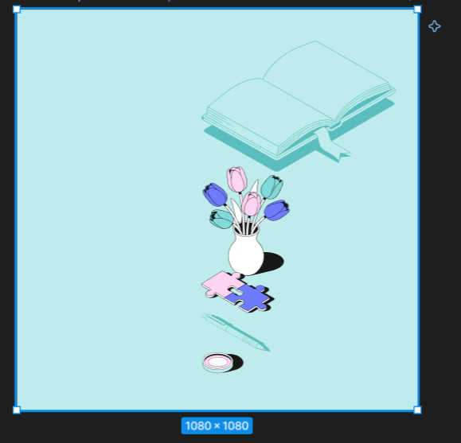
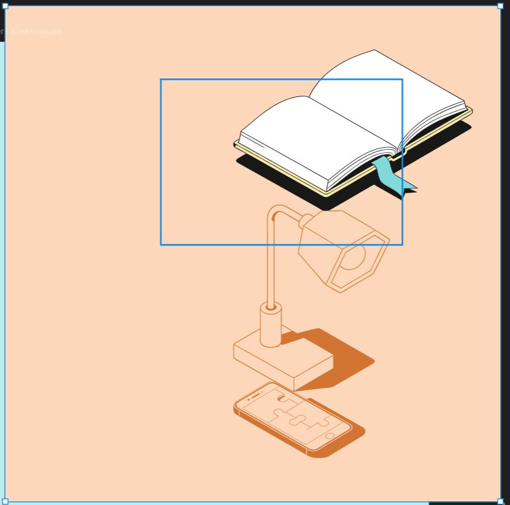
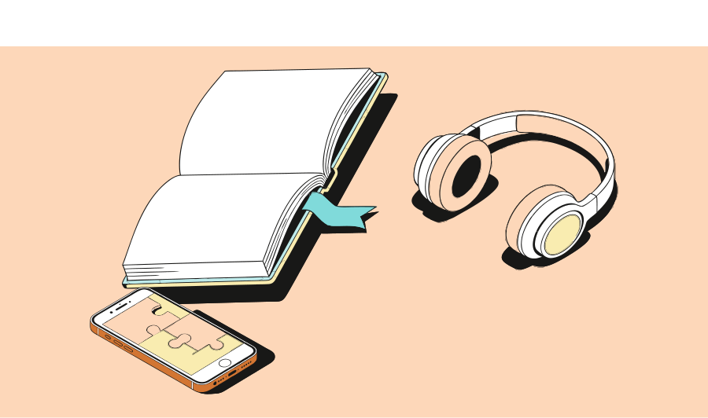

# Краткая демонстрация работы

Ниже — реальные результаты установленного плагина в Figma Desktop, полученные от пользователя и просмотренные оркестратором. Это иллюстрированная демонстрация, не видео и не имитация холста. Значений ключей в материалах нет. Оркестратор не выполнял эти действия за пользователя.

## 1. Композиция и оформление

Пользователь показал квадратную композицию 1080×1080 с палитрой Teal: фоновая книга, цветы, пазл, фоновая ручка и монета. Предметы остаются отдельными векторными слоями Figma.



## 2. Реальный AI в приватном пакете

Пользователь установил приватный NVIDIA-пакет, побайтово совпадающий с release/demo/plugin, и показал результат AI без ручного ввода собственного ключа: главная книга, фоновые лампа и телефон, палитра Peach. Это проверка установленного private UI, а не mock-ответ. Для AI использован OpenRouter с фиксированной моделью nvidia/nemotron-3.5-super-vl:free.



Этот снимок сделан в версии со смешанными ролями: лампа и телефон — фоновые монохромные исходники. В текущей версии AI по умолчанию использует цветные варианты всех предметов. Для такого смешанного результата включите «Разрешить фоновые предметы»; уже созданную сцену можно изменить кнопкой «Сделать все цветными» без нового AI-запроса.

Дополнительно настоящий вызов production-функций в Node прошёл checkConnection за 1685 мс и selectByMetaphor за 1166 мс: book main, phone background, lamp background, cached:false. Эти времена — наблюдение одного запуска, не обещание скорости.

## 3. Ручное редактирование и экспорт

После регистрации плагина пользователь подтвердил цикл перемещение/поворот/дублирование/удаление → палитра → SVG → повторное открытие: «всё работает». Ниже — отрисовка фактически скачанного SVG после ручного изменения и перекраски в Peach.



[Открыть фактический SVG](evidence/desktop-export.svg): 145622 байта, 293 path, 0 images и 3 transforms. Размер 1200×709 отражает изменённые bounds; исходная высота холста после native edits не обещается. Это реальный экспорт пользователя, не заново собранная картинка каталога.

## Воспроизводимые примеры

Одна команда из исходников создаёт и проверяет ещё три композиции без AI:

```powershell
node scripts/create-examples.mjs
```

Проверка без перезаписи: `node scripts/create-examples.mjs --check`.

| Файл | Параметры | Состав |
|---|---|---|
| [01-learning.svg](../examples/01-learning.svg) | 1200×630, L, Под заголовок, violet | книга, ручка; фоновая лампа |
| [02-everyday.svg](../examples/02-everyday.svg) | 1080×1080, S, Собранно, peach | смартфон, кошелёк, монета; без фоновых |
| [03-inspiration.svg](../examples/03-inspiration.svg) | 1080×1350, L, Со смещением, teal | цветы, наушники; фоновый пазл |

Примеры содержат реальные контуры каталога. [palette.json](../examples/palette.json) — пользовательская палитра. Это отдельные локальные образцы, не доказательство AI.

## Повторить самостоятельно

Установите готовый пакет по README. Выберите предметы, формат и палитру, создайте композицию, измените один слой штатными инструментами Figma и скачайте SVG. Закройте плагин, выделите композицию и откройте вновь. Для AI явно включите встроенный demo-ключ либо локально введите свой ключ и проверьте подключение. При отзыве временного ключа замените его своим.

Если добавляемый предмет не помещается при сохранённом масштабе, операция отклоняется без изменения текущей сцены. Создайте новую композицию сразу из полного набора выбранных предметов.

Видеофайл не создавался. Границы проверок и оставшиеся внешние действия — в [verification.md](verification.md). Публикация и отправка работодателю отдельно согласуются.
